<p align="center">
  
</p>

<p align="center">
  
</p>

<p align="center">
  <a href="https://www.linkedin.com/in/oswaldinho24k/"></a>
  
  
  
</p>

---

### 👋 Hey, I'm Oswaldo

A software engineer from Mexico 🇲🇽 with **10 years** of shipping products: fintech, proptech, Web3, payroll, restaurants and government. I started teaching code at Ironhack (including a custom bootcamp for Googlers) and now I build **AI-native apps**, where the agent and the UI share the exact same operations.

```
defineAction('book_court', { description, inputSchema, execute })
        ├── MCP tool       → the agent calls it when it decides to
        ├── REST endpoint  → the UI calls it with fetch
        └── CLI / tests    → runs directly, no server needed
```

No duplicated logic. No dumping data into prompts. Anything irreversible waits for a human.

### 🚀 What I'm working on

| | |
|---|---|
| 🎾 **[Smatch](#)**, *collaborator* | Getting padel out of the chaos of WhatsApp groups: tournaments, leagues, court bookings and rankings for clubs, players, coaches and fans, all in one place. |
| 👻 **[Ghosty](https://ghosty.studio)**, *collaborator* | AI agents that build software with you: Ghosty Studio, Ghosty Teams and the Software Factory. |
| 🧠 **AI-native apps** | Agent-first architecture with MCP, ACP and agent loops on the Anthropic SDK. Same actions for humans and agents. |

### 💼 Where I've been

```
2025 ─ now   Smatch ············ Software Engineer · co-creation
2024 ─ 2026  iCapital ·········· Software Engineer · fintech, $200B+ in alternative investments
2023 ─ 2024  Belong ············ Senior Frontend · design system that cut dev time by ~30%
2022 ─ 2023  SuperRare ········· Frontend · NFT marketplace, smart contract integrations
2021 ─ 2022  Avantica ·········· Full Stack · Appetize/SpotOn, Cheq POS
2019 ─ 2021  Runa ·············· Tech Lead, Platform & Tools · payroll/HR SaaS
2018 ─ 2019  Ironhack ·········· Lead Instructor · first Data Analytics bootcamp in MX, bootcamp for Googlers
2016 ─ 2019  FixterGeek ········ Full Stack · apps for 2 state governments, led a 5-person team
```

### 🛠 Toolbox

<p align="center">
  
</p>

<p align="center"><sub>+ Hono · Express · Drizzle · Nx / Turborepo · MCP · Anthropic SDK · Web3 / Ethers.js</sub></p>

### ⚽ Off the keyboard

- 🎾 **Padel**: I play it and I build for it
- ⚽ **Football**: Liga MX on the weekends (and a fantasy league I'm building)
- 🗣️ I talk tech, sports and life in **Spanish, English and Portuguese**

<p align="center">
  <sub>Hecho en México 🇲🇽 · Feito com ❤️ · Built with agents in the loop</sub>
</p>
